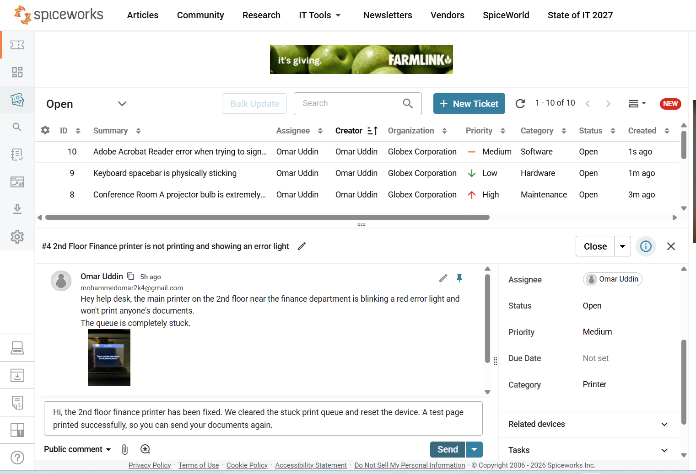
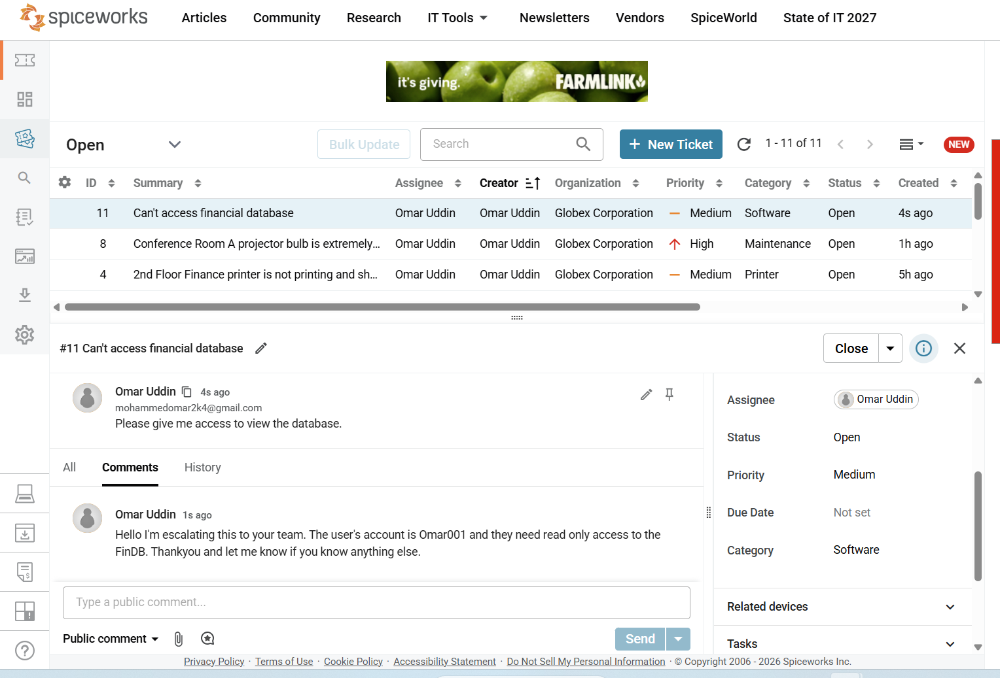

# Spiceworks IT Help Desk & Desktop Support Project

Hey there! Welcome to my desktop support project. I built and configured a simulated corporate help desk environment using Spiceworks to practice real-world IT support workflows, ticket lifecycles, and user escalations.

## What I Did in This Project
* **Help Desk Configuration:** Set up a mock company workspace with custom categories (Hardware, Software, Printer, Network, Maintenance) and agent roles.
* **Ticket Management:** Created 9 realistic user tickets covering everyday office tech issues.
* **Ticket Closure Workflows:** Followed a strict closure checklist to verify fixes, test functionality, and leave clear, professional resolution notes for end-users.
* **Escalation Process:** Handled a complex request (Database Read Access) by following proper security approval channels and escalating it to the Tier-2 / Database Administration team.

## Project Screenshots
Here is a look at some of the workflows and features I set up:

### 1. Spiceworks Ticket Closure Checklist

*Above: Following standard protocol to reply a resolved issue before closing the ticket.*

### 2. Database Read Access Escalation Process

*Above: Documenting the security sign-off and routing a high-permission request up to Tier-2 support.*

## Sample Tickets Handled
* **Hardware:** Laptop screen flickering and cable reseating.
* **Software:** Excel crashing on a corrupted Q3 budget spreadsheet.
* **Network:** Fixing local Wi-Fi drops and refreshing DNS settings.
* **Access Request:** Escalating database read privileges securely.
